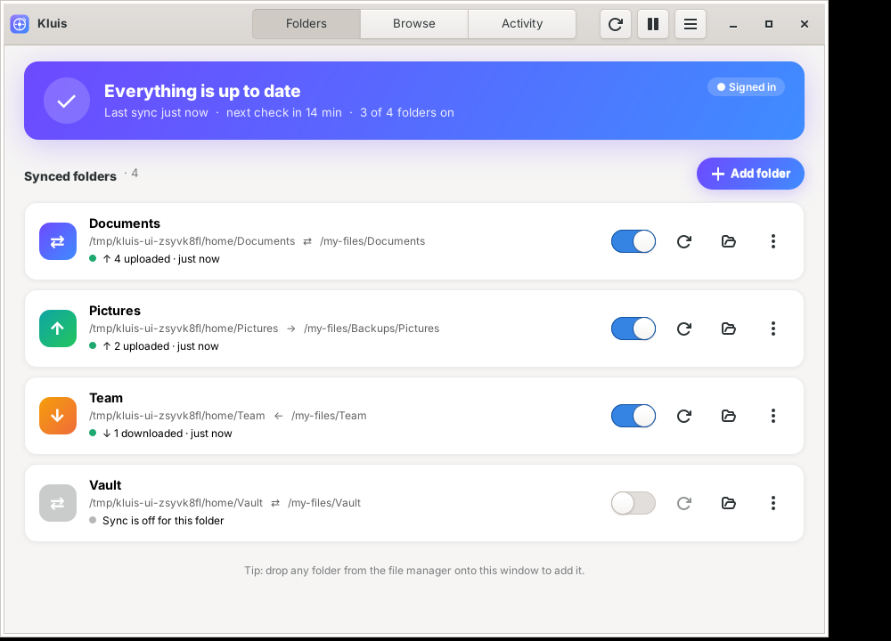
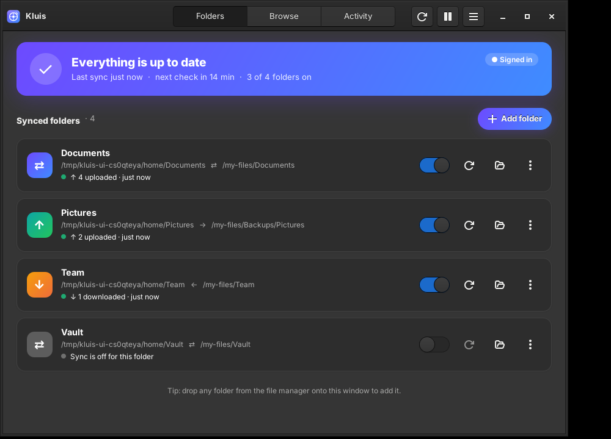
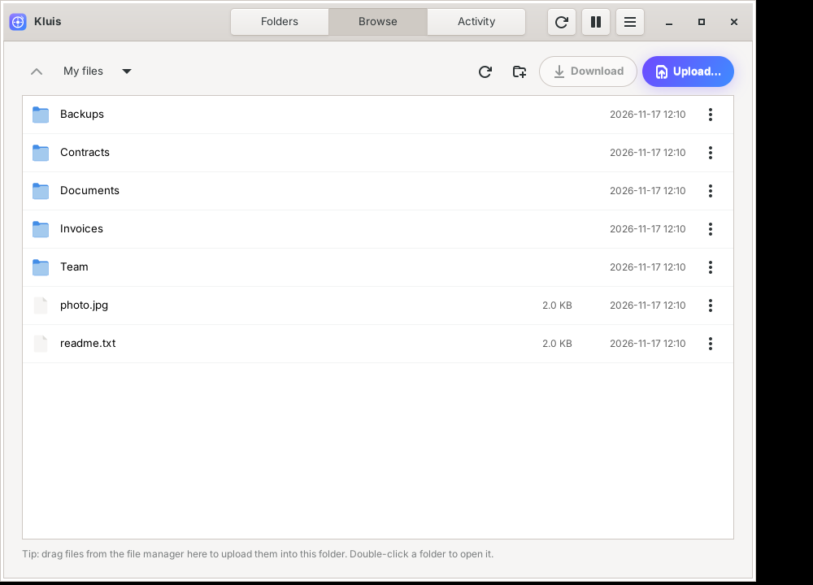
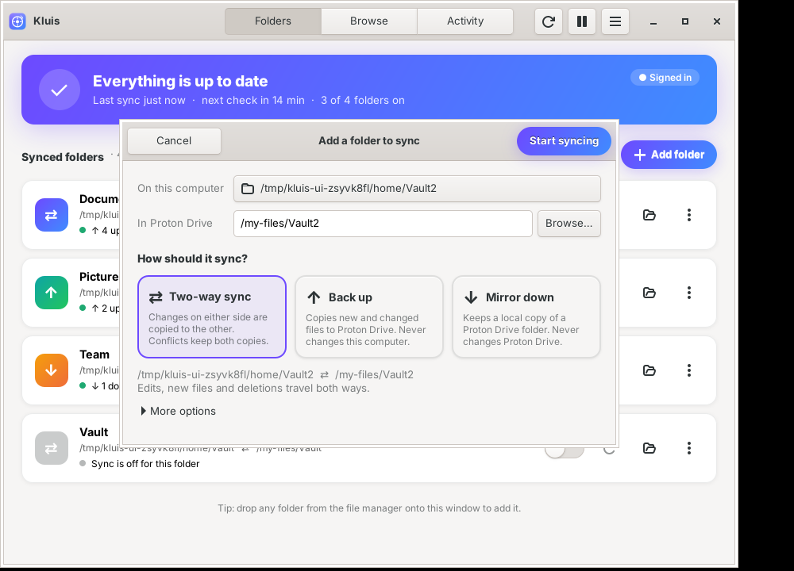
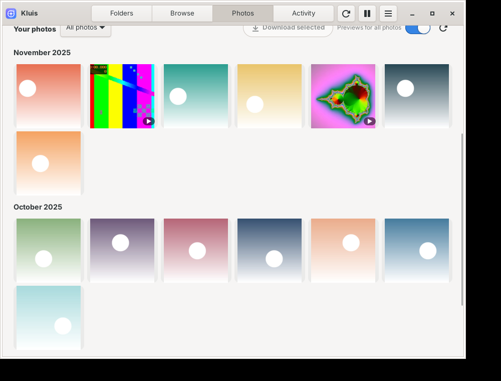
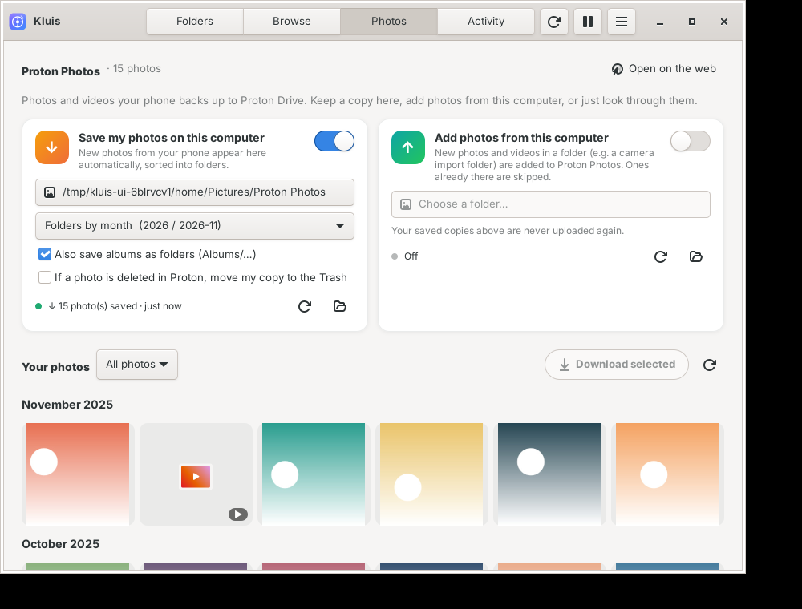

# Kluis: a Proton Drive desktop app for Linux Mint

*Kluis* (Afrikaans for *safe* or *vault*) is an **unofficial** desktop client for Proton Drive.
It does no encryption or networking itself. Every file operation goes through **Proton's official
Proton Drive CLI** (`proton-drive`), so your files stay end-to-end encrypted the way Proton intends.
Not affiliated with Proton AG.



| Dark theme | Browse Proton Drive | Add a folder |
|---|---|---|
|  |  |  |

## Install (about 1 minute)

**Easiest:** download `kluis_<version>_all.deb` from the
[latest release](https://github.com/Sundowna/kluis/releases/latest) and double-click it.

**From source:**

```bash
git clone https://github.com/Sundowna/kluis && cd kluis && ./install.sh
```

Then open **Kluis** from the Mint menu. The first run walks you through three steps:

1. **Get the official CLI.** One click downloads it from `proton.me` and checks Proton's
   SHA-512 checksum.
2. **Sign in.** Your browser opens Proton's own sign-in page, and the session is kept in your keyring.
3. **Pick folders.** Documents, Pictures, or any other folder.

Installs for your user only (`~/.local`), with no `sudo`. Everything it needs is preinstalled on
Linux Mint 21/22. Remove it with `./uninstall.sh` (add `--purge` to also delete settings).

## Features

- **A list of synced folders**, each with its own mode:

  | Mode | What it does |
  |---|---|
  | ⇄ **Two-way** | Edits, new files and deletions travel both ways |
  | ↑ **Back up** | Uploads new and changed files. Never deletes in Proton Drive, never changes this computer |
  | ↓ **Mirror down** | Keeps a local copy of a Proton Drive folder. Never changes Proton Drive |

- **Proton Photos** (the photos your phone backs up), in its own tab:
  - *Save my photos on this computer*: new phone photos land in `~/Pictures/Proton Photos/2026/2026-11/`
    (by month, by year, or one folder). Albums can be saved as folders too. Add-only: deleting a local copy
    never brings it back and never touches Proton.
  - *Add photos from this computer*: new photos/videos in a folder (e.g. camera imports) are added to
    Proton Photos; ones already there are skipped.
  - *Gallery*: your timeline by month, filter by album, double-click to open, multi-select to download.
    Previews for photos **and videos**: made from your saved copies with the same thumbnailers Nemo uses
    (sharing its cache). Photos only in Proton are fetched once in the background and only a ~20 KB
    preview is kept in `~/.cache/kluis/previews` (switch: "Previews for all photos"; videos over 60 MB skipped).

  

  
- **Fast reaction to changes:** local edits sync about 10 seconds after you save. Proton Drive is checked
  every 15 minutes (you can change this).
- **Safe by design:**
  - Nothing is ever deleted for good. Deletions go to the system Trash or the Proton Drive trash.
  - If a file changed on both sides, Kluis keeps both copies: `report (conflict 2026-11-17 1042 laptop).pdf`.
  - Overwritten files stay available as earlier versions in Proton Drive.
  - Files are only marked as synced after their SHA-1 matches what Proton Drive reports.
- **Panel icon** (native XApp icon on Cinnamon, MATE and Xfce) with sync now, pause and quit.
  Closing the window keeps Kluis syncing in the background.
- **Drive browser:** open folders, download, upload (drag files in), create, rename and trash.
- **Drag a folder onto the window** to start syncing it.
- **Activity log** and desktop notifications (all, problems only, or off).
- **Settings:** start at login, start hidden, check interval, light/dark theme,
  one-click CLI update (checksum-verified), sign out.
- Shortcuts: `Ctrl+R` sync, `Ctrl+N` add folder, `Ctrl+,` settings, `Ctrl+Q` quit.

## How it works

```
 Kluis (GTK3, Python)                         Proton's official CLI
 ┌───────────────────────────┐   runs   ┌──────────────────────────────┐
 │ scan local ─┐             │ ───────▶ │ filesystem list / upload /   │──▶ Proton Drive
 │ list remote ┼─▶ plan ─▶ run│          │ download / create-folder /   │    (E2E encrypted)
 │ last state ─┘ (sqlite)    │ ◀─────── │ trash   --json               │
 └───────────────────────────┘   JSON   └──────────────────────────────┘
```

Kluis compares three views of each folder: what is on disk now, what is in Proton Drive now, and
what both looked like after the last sync. From those it works out uploads, downloads, conflicts and
trash moves. It runs one CLI process at a time, as the CLI's local cache requires.

| Where | What |
|---|---|
| `~/.config/kluis/config.json` | settings and folder list |
| `~/.local/share/kluis/state.sqlite` | last-synced state |
| `~/.local/state/kluis/` | `kluis.log`, activity log |
| `~/.local/bin/proton-drive` | the official CLI (if Kluis downloaded it) |

## Known limits (honest list)

- **Remote checks list every folder.** The CLI has no change feed, so each check runs one `list`
  per Proton Drive folder. Large trees (thousands of folders) make periodic checks slow. Local
  changes are still picked up instantly.
- **Proton Docs and Sheets are skipped.** The CLI cannot download them.
- **Renames show up as delete + new file.** The copy in the trash is still recoverable.
- **Built against CLI 0.9.0 (2026-10-05).** If Proton changes command flags, `kluis/cli.py` is the one
  file to adjust.
- When Proton ships its own Linux app, compare the two. Kluis's settings never touch Proton's.

## Development

```bash
python3 tests/test_engine.py        # 33 folder-sync scenarios
python3 tests/test_photos.py        # 12 Proton Photos scenarios
KLUIS_DEBUG=1 python3 -m kluis      # run from the source folder with debug logs
packaging/build-deb.sh              # build dist/kluis_<version>_all.deb
```

`tests/mock_cli/proton-drive` imitates the real CLI's commands, JSON output and error texts
(taken from `ProtonDriveApps/sdk/cli`). It is used for tests only.

Releases: bump `VERSION` in `kluis/__init__.py` and push to `main`. GitHub Actions runs the tests, builds the `.deb` and publishes release `vX.Y.Z` (once per version).

License: GPL-3.0.
