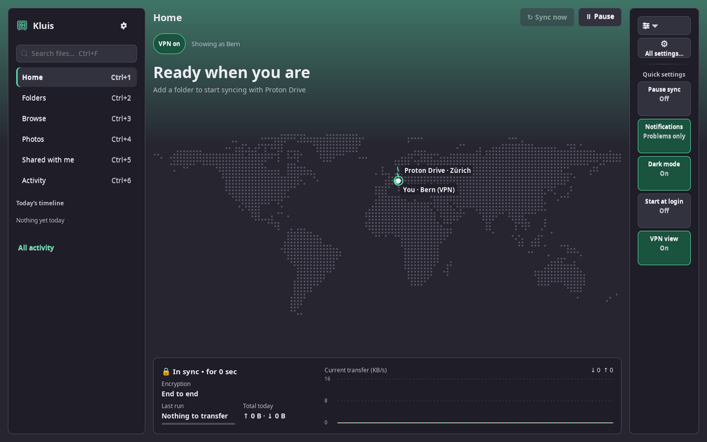
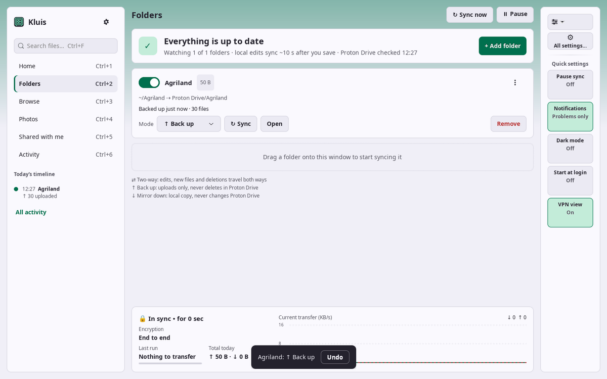
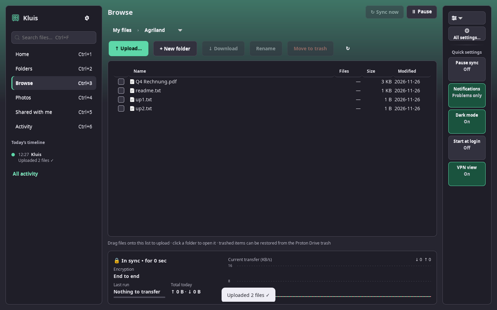
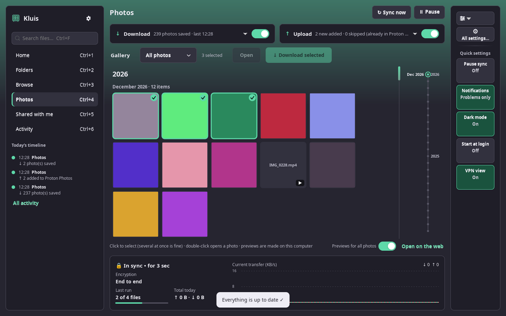
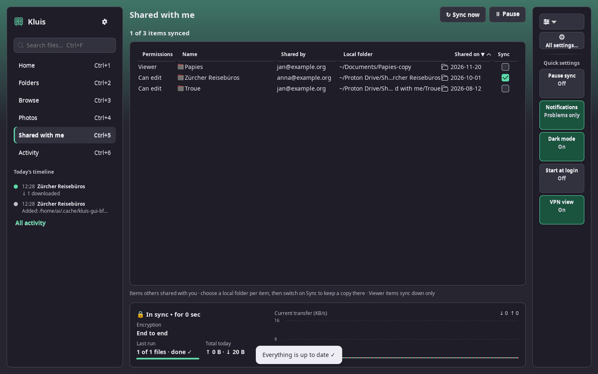
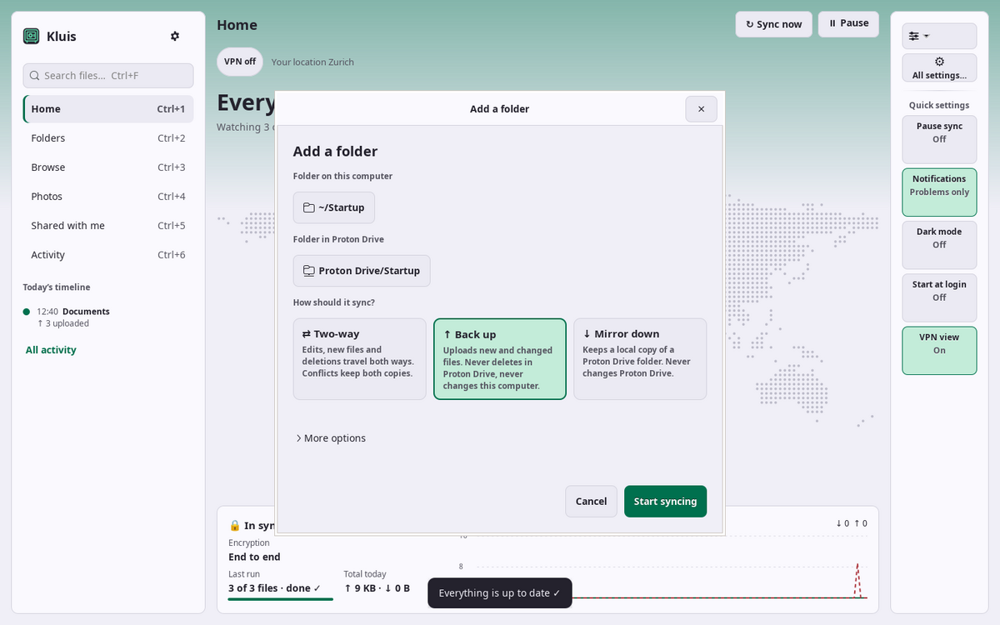
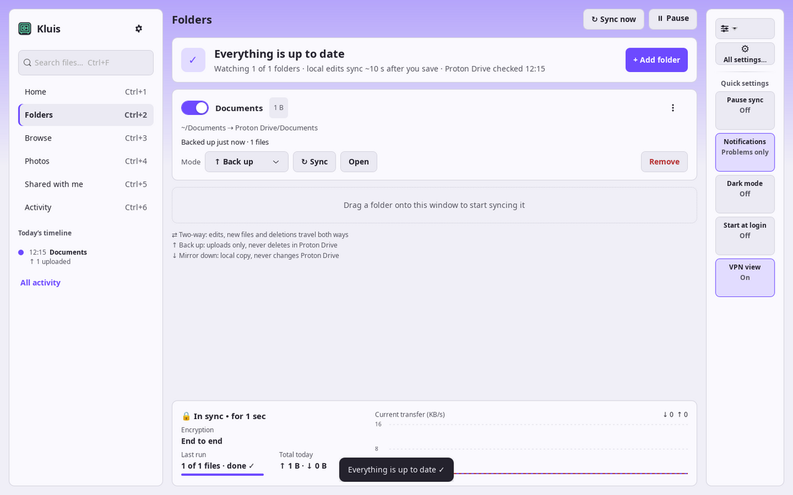
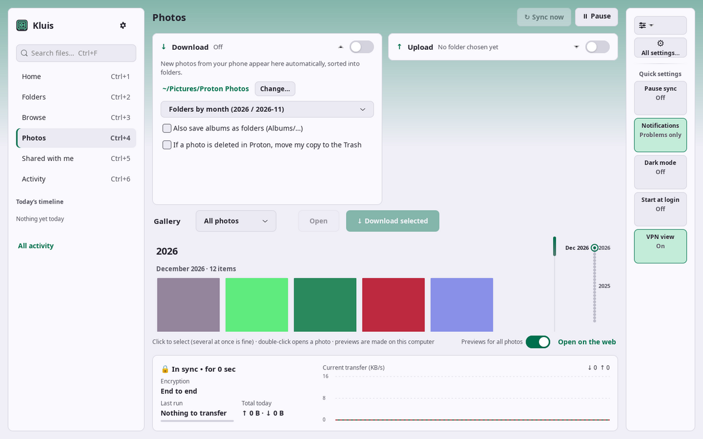

# Kluis: a Proton Drive desktop app for Linux Mint, EndeavourOS and Windows

*Kluis* (Afrikaans for *safe* or *vault*) is an **unofficial** desktop client for Proton Drive.
It does no encryption or networking itself. Every file operation goes through **Proton's official
Proton Drive CLI** (`proton-drive`), so your files stay end-to-end encrypted the way Proton intends.
Not affiliated with Proton AG.



| Folders (light) | Browse Proton Drive | Photos |
|---|---|---|
|  |  |  |
| **Shared with me** | **Add a folder** | **Purple accent** |
|  |  |  |

## Install (about 1 minute)

**Linux Mint / Ubuntu / Debian:** download
[`kluis_latest_all.deb`](https://github.com/Sundowna/kluis/releases/latest/download/kluis_latest_all.deb)
and double-click it.

**EndeavourOS / Arch / Manjaro:** open a terminal (Konsole) and paste:

```bash
curl -LO https://github.com/Sundowna/kluis/releases/latest/download/kluis-latest-any.pkg.tar.zst
sudo pacman -U kluis-latest-any.pkg.tar.zst
```

pacman pulls in everything Kluis needs. To update later, run the same two lines again; to remove:
`sudo pacman -R kluis`. A `PKGBUILD` is in `packaging/arch/` if you prefer `makepkg -si`.

**Windows 10 / 11:** download
[`Kluis-Setup-latest.exe`](https://github.com/Sundowna/kluis/releases/latest/download/Kluis-Setup-latest.exe)
and run it. It installs for your user only (no administrator rights) and adds Kluis to the Start menu. Windows may
say "Windows protected your PC" because Kluis isn't signed by a company: click **More info → Run anyway**. Remove it
in Settings → Apps; your settings stay in `%LOCALAPPDATA%\Kluis`.

Proton also has its own official **Proton Drive app for Windows**. You can use both, but let each folder be synced by
only one of them.

**From source (Linux):**

```bash
git clone https://github.com/Sundowna/kluis && cd kluis && ./install.sh
```

Then open **Kluis** from your app menu. The first run walks you through three steps:

1. **Get the official CLI.** One click downloads it from `proton.me` and checks Proton's
   SHA-512 checksum.
2. **Sign in.** Your browser opens Proton's own sign-in page, and the session is kept in your keyring.
3. **Pick folders.** Documents, Pictures, or any other folder.

`./install.sh` installs for your user only (`~/.local`). It checks for what Kluis needs and offers to
install anything missing with apt or pacman. Remove it with `./uninstall.sh` (`--purge` also deletes settings).

**Sign-in on KDE:** Proton's CLI keeps your session in the system keyring. On KDE that is KWallet. If sign-in
isn't remembered, install `gnome-keyring` (`sudo pacman -S gnome-keyring`) and log out and in once.

## Features

- **A list of synced folders**, each with its own mode:

  | Mode | What it does |
  |---|---|
  | ⇄ **Two-way** | Edits, new files and deletions travel both ways |
  | ↑ **Back up** | Uploads new and changed files. Never deletes in Proton Drive, never changes this computer |
  | ↓ **Mirror down** | Keeps a local copy of a Proton Drive folder. Never changes Proton Drive |

- **Proton Photos** (the photos your phone backs up), in its own tab:
  - *Save my photos on this computer*: new phone photos land in `~/Pictures/Proton Photos/2026/2026-11/`
    (by month, by year, or one folder). Albums can be saved as folders too. Add-only: deleting a local copy
    never brings it back and never touches Proton.
  - *Add photos from this computer*: new photos/videos in a folder (e.g. camera imports) are added to
    Proton Photos; ones already there are skipped.
  - *Gallery*: your timeline by month, filter by album, double-click to open, multi-select to download.
    Previews for photos **and videos**: made from your saved copies with the same thumbnailers Nemo uses
    (sharing its cache). Photos only in Proton are fetched once in the background and only a ~20 KB
    preview is kept in `~/.cache/kluis/previews` (switch: "Previews for all photos"; videos over 60 MB skipped).

  
- **Home:** a world map with your location (or your Proton VPN exit, read from NetworkManager) and Proton Drive
  in Zürich, plus a status panel with today's transfers and a live transfer graph. No geo-IP lookups.
- **Fast reaction to changes:** local edits sync about 10 seconds after you save, even while a sync is running.
  Proton Drive is checked every 5, 15, 30 or 60 minutes.
- **Safe by design:**
  - Nothing is ever deleted for good. Deletions go to the system Trash or the Proton Drive trash.
  - If a file changed on both sides, Kluis keeps both copies: `report (conflict 2026-11-17 1042 laptop).pdf`.
  - Overwritten files stay available as earlier versions in Proton Drive.
  - Files are only marked as synced after their SHA-1 matches what Proton Drive reports.
  - Downloads land in a hidden `.kluis-part` folder and are moved into place only when complete and verified.
  - **Mass-deletion guard:** more than 50 files (or 10 % of a folder) about to go to a trash? Kluis pauses and asks.
  - **Missing-folder guard:** an unplugged drive is never treated as "everything was deleted".
  - Offline, disk full or signed out: syncing pauses and resumes by itself, with backoff (at most every 15 min).
- **Shared with me:** keep a copy of items others share with you. Viewer items sync down only.
- **Always the latest official CLI:** every new version is SHA-512 checked and must pass a capability self-test
  before Kluis uses it. `kluis --selftest` proves your account works, in its own test folder only.
- **Panel icon** with sync now, pause and quit: XApp's native icon on Cinnamon, MATE and Xfce;
  the standard system-tray icon on KDE Plasma (EndeavourOS) and other desktops.
  Closing the window keeps Kluis syncing in the background.
- **Drive browser:** open folders, download, upload (drag files in), create, rename, and trash with Undo.
  Folder sizes and file counts, resizable columns.
- **More than one Proton account**, switched like on proton.me: the account button at the top right opens a menu
  with your account, *Sign out*, and *Other accounts*. Add another account once (Proton's browser sign-in), then
  switch with one click. Each account keeps its own folders, photo settings and sync history, and only the active
  account syncs. Two accounts can't sync the same folder. If Proton no longer accepts a kept session, Kluis asks
  for that account's browser sign-in.
- **Big files and big folders don't block the rest:** a file of 1 GB or more, or a folder with 1 GB or more to
  transfer (a holiday's photos, a backup), syncs in its own lane next to everything else. In *Activity* you can
  pause a big item, resume it or send it first. Paused items continue by themselves once nothing else has synced
  for 5 minutes (or 15, 30, 60, or never: Settings).
- **Drag a folder onto the window** to start syncing it.
- **Activity log** and desktop notifications (all, problems only, or off).
- **Quick settings** column and **Settings:** your Proton Drive folder (move it safely), start at login,
  start hidden, check interval, theme, notifications, home location, Kluis update notices (never installs
  by itself), CLI updates, sign out, and "Copy diagnostics" (no email, tokens or private paths).
- **Search** (`Ctrl+F`) finds names in your synced folders and in the folder open in Browse, including all its
  subfolders. The CLI has no server-side search, so Kluis searches what it has read.
- Shortcuts: `Ctrl+1…6` tabs, `Ctrl+F` search, `Ctrl+R` sync, `Ctrl+N` add folder, `Ctrl+,` settings, `Ctrl+Q` quit.

## How it works

```
 Kluis (GTK3, Python)                         Proton's official CLI
 ┌───────────────────────────┐   runs   ┌──────────────────────────────┐
 │ scan local ─┐             │ ───────▶ │ filesystem list / upload /   │──▶ Proton Drive
 │ list remote ┼─▶ plan ─▶ run│          │ download / create-folder /   │    (E2E encrypted)
 │ last state ─┘ (sqlite)    │ ◀─────── │ trash   --json               │
 └───────────────────────────┘   JSON   └──────────────────────────────┘
```

Kluis compares three views of each folder: what is on disk now, what is in Proton Drive now, and
what both looked like after the last sync. From those it works out uploads, downloads, conflicts and
trash moves. It runs one CLI process at a time, as the CLI's local cache requires.

| Where | What |
|---|---|
| `~/.config/kluis/config.json` | settings and folder list |
| `~/.local/share/kluis/state.sqlite` | last-synced state (first Proton account) |
| `~/.local/share/kluis/accounts/<id>/` | each further account's sync state and Proton CLI cache |
| keyring: "Kluis: Proton session for …" | each signed-in account's Proton session, while another one is active |
| `~/.local/state/kluis/` | `kluis.log`, activity log |
| `~/.local/bin/proton-drive` | the official CLI (if Kluis downloaded it) |

On Windows the same files are in `%LOCALAPPDATA%\Kluis\` (`config`, `data`, `state`, `bin\proton-drive.exe`), kept
sessions are in Credential Manager ("dev.kluis.Kluis/account/…"), and deleted files go to the Recycle Bin.

## Known limits (honest list)

- **Remote checks list every folder.** The CLI has no change feed, so each check runs one `list`
  per Proton Drive folder. Large trees (thousands of folders) make periodic checks slow. Local
  changes are still picked up instantly.
- **Proton Docs and Sheets are skipped.** The CLI cannot download them.
- **Renames show up as delete + new file.** The copy in the trash is still recoverable.
- **Always the newest CLI, but only if it passes the capability self-test.** If Proton changes command flags,
  Kluis keeps the previous CLI and says "Proton changed its Drive tool. Kluis needs an update for it."
  `kluis/cli.py` and `kluis/capabilities.py` are the files to adjust. See `docs/cli-capabilities.md`.
- **One account syncs at a time.** Proton's CLI holds one session per Linux user, so the other accounts' folders
  wait until you switch to them. Switching needs a desktop keyring (GNOME Keyring or KWallet's Secret Service);
  without one, every switch is a browser sign-in.
- **Windows: some Proton Drive names can't exist on Windows** (`a:b.txt`, `notes.`, `CON.txt`, or `Notes.txt` next
  to `notes.txt`). Kluis leaves such items out, never deletes them, and says so in Activity; rename them on the web
  (or on Linux/Mac) to sync them. On drives without a Recycle Bin (USB sticks, network shares) Kluis never deletes
  local files for a deletion in Proton Drive; it leaves them and says so.
- **A paused big file starts over.** Proton's CLI can't continue an upload or download where it stopped, so a
  big file paused halfway is transferred from the beginning when it continues. A big folder keeps the files that
  were done. There is no percentage for a single big file: the CLI reports bytes only when it is finished.
- **No storage figure.** The CLI has no quota command, so Kluis shows no "space used" (never a guess).
- When Proton ships its own Linux app, compare the two. Kluis's settings never touch Proton's.

## Development

```bash
python3 tests/test_engine.py        # folder-sync scenarios
python3 tests/test_lane.py          # big files and folders: own lane, pause, resume, send first
python3 tests/test_photos.py        # Proton Photos scenarios
python3 tests/test_safety.py        # one test per safety rule (HANDOVER §7)
python3 tests/test_units.py         # status text, ring mapping, migration, contrast …
python3 tests/test_lint.py          # static checks + every module imports
tests/gui/run_all.sh /tmp/flows     # GUI flows F1–F25 under Xvfb, light/dark × 1440x900/1024x640
python tests/gui/run_windows.py out # the same flows on Windows (MSYS2 UCRT64 Python with GTK 3)
KLUIS_DEBUG=1 python3 -m kluis      # run from the source folder with debug logs
python3 -m kluis --selftest         # real account, own test folder only
packaging/build-deb.sh              # build dist/kluis_<version>_all.deb
packaging/windows/build.sh          # build dist/Kluis-Setup-<version>.exe (MSYS2 UCRT64 + Inno Setup)
```

The 1.0 redesign's handover, decisions and feature inventory are in `docs/redesign/`.

`tests/mock_cli/proton-drive` imitates the real CLI's commands, JSON output and error texts
(taken from `ProtonDriveApps/sdk/cli`). It is used for tests only.

Releases: bump `VERSION` in `kluis/__init__.py` and `pkgver` in `packaging/arch/PKGBUILD`, then push to `main`.
GitHub Actions builds the `.deb` (Ubuntu), the pacman package (in an Arch Linux container) and the Windows installer
(MSYS2 GTK 3 + PyInstaller + Inno Setup), installs and starts each, and publishes release `vX.Y.Z` once all pass.

License: GPL-3.0.
